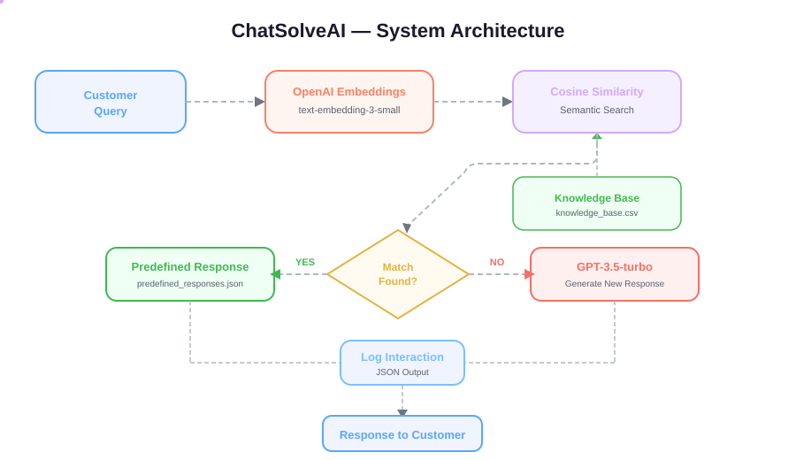

# Automating Customer Support with AI

A chatbot that answers common customer questions on its own, using approved answers when it can and writing a new reply when it can't.

## Project Description

This project is a customer support chatbot. A customer types a question, such as "How do I reset my password?", and the chatbot replies right away. It first looks through a list of answers the company has already written and approved. If none of them fits, it asks an AI model (a computer program trained on huge amounts of text to understand and write language) to write a new answer.

The clever part is how it finds the right answer. It doesn't just look for matching words. It compares the **meaning** of the question with the meaning of each saved answer. So "When can I talk to someone from support?" can still match an answer about support hours, even though the wording is different.

Think of it like an experienced receptionist with a binder of standard answers. When a question comes in, they flip to the page that best fits it. If nothing in the binder fits, they write a reply themselves. They also note every conversation in a logbook.

We built this for a practical exam on DataCamp (an online learning platform for data and AI skills). The exam is set at a made-up company called **ChatSolveAI**. We have since tidied it up as a portfolio project. It runs as a Jupyter notebook (an interactive document that mixes code, results and notes) and uses services from OpenAI (the company behind ChatGPT).

**How to read this diagram**

1. **Customer Query:** a customer types a question in plain text.
2. **OpenAI Embeddings:** the question is turned into a list of numbers that captures its meaning. We call this an "embedding". It works like a fingerprint for meaning.
3. **Knowledge Base → Cosine Similarity:** the chatbot compares the question's fingerprint with the fingerprints of saved questions and answers. It gives each one a score from roughly 0 (unrelated) to 1 (the same meaning).
4. **Match Found?:** the chatbot checks whether the best score is high enough (0.75 or more).
5. **YES → Predefined Response:** if it is, the chatbot returns the approved answer the company already wrote.
6. **NO → GPT-3.5-turbo:** if it isn't, an AI model writes a new answer instead.
7. **Log Interaction:** the chatbot records the question, the answer, the time and the score in a file.
8. **Response to Customer:** the customer receives the answer.

## Why This Project Exists

**The problem:** support teams answer the same questions again and again. "Where is my order?" "How do I reset my password?" "What are your opening hours?" Each one takes a person's time, and customers wait while they queue.

**An example:** picture a small online shop with two support staff. Every morning they find 200 new messages. Most of them could be answered by copying and pasting an answer they've written a hundred times before. Meanwhile, the few customers with real, unusual problems wait hours for a reply.

**How this project helps:**
- **Instant answers to common questions.** The chatbot replies straight away using the company's own approved wording.
- **It understands rephrasing.** Customers don't have to use the "right" words for the chatbot to find the answer.
- **It still answers new questions.** When no saved answer fits, the AI writes one, so the customer isn't left with nothing.
- **A record of everything.** Each conversation is logged with a time and a confidence score (how sure the chatbot was). The team can check what the chatbot said and spot gaps in their saved answers.

The exam also gave us a personal reason to build it: it is a hands-on way to learn the core pieces behind many real AI assistants.

## Thought Process & Approach

We describe the steps **in the order we built them**, which follows the three exam tasks. This is also roughly the order the system works in.

### Step 1: Turning documents into "meaning fingerprints"
- **What it does:** we take about 500 help documents from the knowledge base and turn each one into an embedding (a list of numbers that represents its meaning). We save them in a file so we can search them later.
- **Why we did it this way:** a computer can't compare meanings directly, but it can compare numbers. Embeddings turn "these two sentences mean similar things" into simple maths. We send all the documents to OpenAI in **one batch request** instead of one at a time. That makes it faster and less likely to hit OpenAI's limit on how many requests we can send per minute.
- **What we considered instead:** sending one request per document. It is simpler to write but much slower, and with 500 documents it risks being blocked by those limits.
- **Trade-off:** we gained speed and reliability. We gave up a little flexibility: if one document in the batch has a problem, the whole batch fails together.

### Step 2: Finding the best answers for each question
- **What it does:** we take about 500 example customer questions and turn each into an embedding. Then we compare each one with a set of 19 approved answers and keep the **top 3 matches**, each with a confidence score.
- **Why we did it this way:** we measure closeness with "cosine similarity". Think of each fingerprint as an arrow pointing in some direction. Two arrows pointing the same way mean the texts have similar meanings. It is a standard, well-understood method and gives a clear score. We keep three answers rather than one so a person or another system can see the alternatives too.
- **What we considered instead:** matching on keywords, which fails when customers use different words. Asking the AI model to answer every question directly, which costs more and could stray from the company's approved wording.
- **Trade-off:** answers stay consistent and on-message. But the chatbot can only be as good as the list of approved answers it has to choose from.

### Step 3: Coping with temporary failures
- **What it does:** if a request to OpenAI fails, for example because we sent too many too quickly, the code waits and tries again, up to 3 times.
- **Why we did it this way:** online services sometimes refuse requests for a moment. We wait a bit longer after each failed try (1 second, then 2 seconds). This is called "exponential backoff" and is a common, polite way to retry without overloading the service.
- **What we considered instead:** giving up on the first error, which would make the whole run fragile.
- **Trade-off:** the system is much more robust. In return, a run can take a few seconds longer when things go wrong. (At the moment this retry logic is only used in Step 2. See Limitations.)

### Step 4: Deciding "reuse an answer or write a new one"
- **What it does:** for each live question, the chatbot finds its single best match. If the confidence score is **0.75 or higher**, it uses the approved answer. If not, it moves on to Step 5.
- **Why we did it this way:** a cut-off score (a "threshold") is a simple, transparent rule. Anyone can understand it and change it. A fairly high cut-off means the chatbot only gives an approved answer when it is quite sure the answer fits.
- **What we considered instead:** always using the best match, however weak. That risks confidently answering the wrong question.
- **Trade-off:** fewer wrong "canned" answers, but more questions go to the AI model. In our tests, even a reworded support-hours question scored below 0.75 and went to the AI. The right threshold needs tuning (see Limitations).

### Step 5: Writing a new answer when nothing fits
- **What it does:** the chatbot sends the question to **GPT-3.5-turbo**, an AI model that writes text. We tell it to act as a "helpful customer support assistant" and to answer clearly and briefly.
- **Why we did it this way:** it means the customer always gets a reply, even to a question nobody planned for. We limit replies to roughly 100 words (150 "tokens", the small chunks of text AI models count in). We use a moderate "temperature" (0.7), a setting that controls how creative or predictable the wording is. The exam specified this model.
- **What we considered instead:** replying "Sorry, I don't know" or handing the question to a human. Both are safer but less helpful.
- **Trade-off:** the customer gets an answer instead of a dead end. But the AI model **doesn't see the company's knowledge base**, so its answers are general and could be wrong about this company's actual policies.

### Step 6: Logging every conversation
- **What it does:** each interaction is saved with the question, the answer, a timestamp and the confidence score, in a JSON file (a common, structured text format that other software can easily read).
- **Why we did it this way:** a log lets the team review what the chatbot said, check its quality, and spot common questions that deserve their own approved answer. JSON is easy to plug into other tools.
- **Trade-off:** simple and portable, but a single file isn't built for many users at once or for long-term storage.

### Step 7: Testing with tricky questions
- **What it does:** we ran the chatbot on four test questions. They included a **reworded** question ("When can I talk to someone from support?") and a question with **no saved answer** (a refund question about downloaded software).
- **Why we did it this way:** these two cases test the two things that matter most. Does it understand meaning rather than exact words? And does it cope sensibly when it has no answer? The results are saved in `outputs/sample_chatbot_responses.json`.
- **Trade-off:** four questions are enough to show how it behaves, but not enough to measure how accurate it is overall.

## Tech Stack

| Tool / Technology | Why we used it |
|---|---|
| **Python** | It is the standard language for data and AI work, and it is what the exam uses. |
| **Jupyter Notebook** | It lets readers follow each task step by step and see the outputs. |
| **OpenAI API** | An API is a way for our code to send requests to another service, like a waiter passing your order to the kitchen. It gives us powerful AI models without having to build or host them ourselves. |
| **text-embedding-3-small** | It is fast, cheap and good at capturing meaning. The exam specified it. |
| **GPT-3.5-turbo** | It writes new answers when no approved answer fits. The exam specified it. |
| **pandas** | A Python tool for working with tables of data, like a spreadsheet you control with code. It loads the CSV files of documents and questions. |
| **NumPy** | A Python tool for fast maths on lists of numbers. It calculates the similarity scores between fingerprints. |
| **Cosine similarity** | It is a standard, easy-to-explain way to score how similar two texts are. |
| **CSV files** | They store the knowledge base and the example customer questions. |
| **JSON files** | They store the approved answers, the saved fingerprints and the chatbot's logs. |

## Limitations

- **The AI-written answers don't know the company's policies.** When no saved answer fits, the AI model only sees the customer's question, not the company's documents. *In practice:* asked about refunds, it gave a general answer ("refund policies vary…") instead of the company's actual 30-day policy, even though that policy exists in our data. It could also state something incorrect with confidence.
- **The 0.75 cut-off is not tuned.** *In practice:* in our tests, "What are your business hours?" scored 0.56 and the reworded support-hours question scored 0.68. Both missed the cut-off, so the AI wrote answers instead of using the approved one. The AI's answers happened to look reasonable, but they weren't the company's official wording.
- **"Confidence" is a similarity score, not a probability.** *In practice:* a score of 0.8 means "quite similar in meaning", not "80% likely to be correct". It is useful for ranking answers but shouldn't be read as a guarantee.
- **The chatbot has no memory between questions.** Each question is handled on its own. *In practice:* a follow-up like "And what about international orders?" won't be understood in the context of the previous question.
- **The live chatbot has no retry logic.** Only Step 2 retries failed requests. *In practice:* a brief hiccup at OpenAI could make the chatbot fail on a question instead of trying again.
- **Small, practice-only data.** The live chatbot chooses from 19 saved question-and-answer pairs. The knowledge base documents are template text made for the exam. *In practice:* it shows the method works but isn't ready for a real company's support load.
- **The knowledge base isn't connected to the live chatbot.** The document fingerprints from Step 1 are created and saved but not yet used to answer customers. *In practice:* most of the "knowledge" isn't available when the chatbot replies.
- **No user interface.** It runs inside a notebook. *In practice:* there is no chat window for real customers yet. Someone has to run the code.
- **It needs an OpenAI account and costs a little per use.** Every question sends at least one request to OpenAI. *In practice:* running it needs an API key (a private password for the service), it costs money at scale, and it stops working if OpenAI is unavailable.
- **The search checks every saved answer one by one.** *In practice:* this is fine for 19 answers, but it would slow down with many thousands.
- **The AI model is an older one.** GPT-3.5-turbo was required by the exam. *In practice:* newer models usually write more accurate and better-reasoned answers.
- **Accuracy hasn't been measured.** We tested four questions by hand. *In practice:* we can't yet say how often the chatbot gives the right answer.

## Future Improvements

**Short term**
- **Tune the cut-off score.** Test a range of thresholds against a set of questions with known correct answers. *Benefit:* more questions get the approved answer, and fewer go to the AI unnecessarily.
- **Add retries to the live chatbot.** Reuse the retry logic from Step 2. *Benefit:* the chatbot keeps working through brief OpenAI hiccups.
- **Measure accuracy.** Build a small labelled test set and track how often the right answer is chosen. *Benefit:* we can show real results and see whether changes help.
- **Add a "hand over to a human" option.** For low-confidence or sensitive questions, offer to pass the customer to a person. *Benefit:* safer answers on topics like refunds or billing.

**Long term**
- **Give the AI model the company's documents when it writes an answer.** This is called "retrieval-augmented generation" (RAG): we search the knowledge base first and pass the relevant documents to the AI with the question. *Benefit:* new answers follow the company's real policies instead of guessing. This also puts the Step 1 knowledge base to work.
- **Remember the conversation.** Pass earlier messages to the AI so it understands follow-up questions. *Benefit:* more natural, back-and-forth conversations.
- **Build a simple chat interface.** A web page or chat widget where customers can type questions. *Benefit:* real people can use it without touching any code.
- **Use a proper database for fingerprints and logs.** A "vector database" (a database built for searching by meaning) and a regular database for logs. *Benefit:* fast search across thousands of answers, and safe storage of many conversations.
- **Upgrade the AI models.** Try newer models for writing answers. *Benefit:* clearer, more accurate replies, possibly at lower cost.
